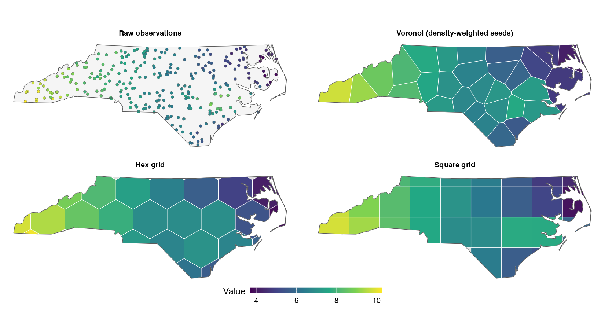
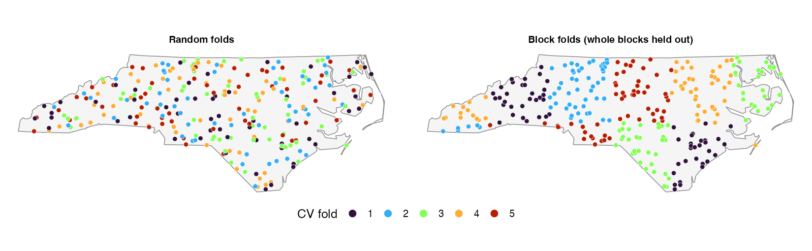

<!-- README.md is generated from README.Rmd. Edit the .Rmd and knit. -->

# spatialkit

<!-- badges: start -->

[](https://CRAN.R-project.org/package=spatialkit)
[](https://github.com/elkronos/gis_modeling_toolkit/actions/workflows/R-CMD-check.yaml)
<!-- badges: end -->

spatialkit draws analysis regions, which it calls cells, from where your
observations are, instead of borrowing boundaries drawn for other
purposes, and summarises point data onto them with a count, a standard
error and a pooled value for every cell. It then scores regression
models on cross-validation folds that hold out whole blocks of space,
and marks where a fitted map extrapolates.

## The problem this solves

You have observations at points and need values over areas. The usual
move is to borrow boundaries that already exist: ZIP code areas, census
tracts, counties, sales territories. They were drawn for mail delivery,
enumeration or politics, not for the process you are studying, so part
of any answer aggregated onto them comes from the partition. This is the
modifiable areal unit problem: the same observations, aggregated under
different boundaries, can give different conclusions.

spatialkit draws the cells from the data, in three steps:

1.  Pick a cell count. `resolution_profile()` and `select_resolution()`
    set it from a size of 4.5 observations per cell by default, and
    report the leave-one-out error of the cell values. Given a ladder of
    counts, the profile scores each one against the spatial structure of
    the observations.
2.  Place the cells. `get_voronoi_seeds()` places seeds by
    density-weighted k-means, so cells are small where observations are
    dense, and `build_tessellation()` grows Voronoi cells from them (or
    lays hex or square cells, or Delaunay triangles), clipped to your
    study area. Cell IDs stay the same when the rows are reordered.
3.  Summarise. `summarize_by_cell()` gives each cell a count, a mean
    with its standard error, and a pooled value: the cell’s mean pulled
    toward the mean of the observations in the 8 nearest cells (nearest
    by the centroid of their observations). When the cell means stand in
    for a population mean, it can correct the standard errors for
    autocorrelation within the cells, which on a correlated field can
    double them or more.

The first figure shows a simulated field on 280 random sites in North
Carolina, aggregated onto three kinds of cells, about 30 of each:
Voronoi cells from density-weighted seeds, a hex grid and a square grid.

<figure>

<figcaption aria-hidden="true">Four maps of North Carolina: a simulated
field at 280 sites, and its cell means on 30 Voronoi cells from
density-weighted seeds, on a hex grid and on a square grid</figcaption>
</figure>

The next figure cuts the same field at three cell counts, each cell
showing its pooled value. `resolution_profile()` scores each count by
the leave-one-out error of the pooled values at that count. The error is
0.33 at 12 cells, 0.18 at 62 cells (the count the default size of 4.5
observations per cell gives) and 0.18 at 140 cells (two per cell). The
12 cells blur the hotspot in the east. At 140 cells the error is within
one standard error of the default’s. `vignette("resolution")` covers how
the count is chosen.

<figure>

<figcaption aria-hidden="true">Four maps of North Carolina: the
simulated field at 280 sites, and its pooled cell values at 12, 62 and
140 Voronoi cells, where 62 is the default count</figcaption>
</figure>

The second half of the package tests the result. Three model backends
(random forest, GWR and a Bayesian GP) sit behind one `spatial_fit`
class, so they can be scored on the same folds. Cross-validation holds
out whole blocks, of a grid by default, which can be sized from the
data’s own autocorrelation range or matched to the locations a map will
predict at. An area-of-applicability estimate marks where the resulting
score applies. All of it is built on
[`sf`](https://r-spatial.github.io/sf/), with CRS handling that will not
hand metres to a function expecting degrees.

Random folds put a test point’s neighbours in the training set, so a
model that can memorise location is scored on points it has nearly seen.
Block folds hold out whole blocks instead; the quick start below shows
the difference in RMSE.

<figure>

<figcaption aria-hidden="true">Two maps of North Carolina: 280 sites
coloured by fold, mixed at random on the left and grouped into spatial
blocks on the right</figcaption>
</figure>

## Scope

- **Regression, with one exception.** `fit_rf_model()` and
  `fit_gwr_model()` fit a numeric response and refuse a logical, factor
  or character one; `fit_gwr_model()` also refuses an integer-coded
  two-valued response and points to `GWmodel::ggwr.basic()`. The
  exception is `fit_bayesian_spatial_model()`, which also fits a binary
  response under `brms::bernoulli()`, and a factor or character response
  under `brms::categorical()` or an ordinal family. `cv_bayes()` refuses
  the categorical and ordinal families, because it scores one predicted
  number per row.
- **Vector data only.** There is no raster input or output:
  `predict_surface()` returns an `sf` POINT layer, which you convert
  yourself if you need a `SpatRaster`. The models work on points:
  `prep_model_data()` and `coerce_to_points()` reduce lines and polygons
  to points.
- **No areal or lattice models.** Moran’s I here tests residuals for
  spatial structure. There is no CAR, SAR or spatial-lag fitter.
- **No spatio-temporal folds.** Every fold scheme is spatial; none holds
  out time.

## Installation

``` r
install.packages("spatialkit")
```

The development version installs from GitHub:

``` r
# install.packages("remotes")
remotes::install_github("elkronos/gis_modeling_toolkit")
```

`sf`, `dplyr`, `logger`, `digest` and `FNN` install with it. Optional
packages switch on the model backends, variograms and plots; [Get
started](https://elkronos.github.io/gis_modeling_toolkit/articles/getting-started.html)
lists which does what. If you are upgrading from 2.0.0, the
[changelog](https://elkronos.github.io/gis_modeling_toolkit/news/index.html)
lists the defaults that change results and the argument that restores
each.

## Quick start

A simulated field of 400 observations in a 1,000 m square, with one weak
measured predictor `w`:

``` r
library(sf)
library(spatialkit)

set.seed(42)
n  <- 400
xy <- data.frame(x = 5e5 + runif(n, 0, 1000), y = 5e6 + runif(n, 0, 1000))
D  <- as.matrix(dist(xy))
xy$w <- rnorm(n)
# Mostly a smooth spatial field (exponential, effective range 3 x 80 = 240 m),
# with the weak predictor on top.
xy$z <- 0.5 * xy$w +
  as.numeric(t(chol(exp(-D / 80) + diag(1e-8, n))) %*% rnorm(n)) +
  rnorm(n, sd = 0.3)
site <- st_as_sf(xy, coords = c("x", "y"), crs = 32632)
```

Set the cell count, draw Voronoi cells from the data and summarise onto
them:

``` r
size <- select_resolution(resolution_profile(site, "z"))
size
#> Resolution by size: 89 cells
#>   size        : 4.5 rows per cell, the default (obs_per_cell); 400 rows / 89 cells = 4.49
#>   cells       : density-weighted k-means++ starts (power 1, 8 neighbours)
#>   estimate    : pooled toward the 8 nearest cells
#>   at this size: 0.0% of the rows are alone in their cell; median own weight 0.78
#>   loo         : 0.912 (one cell for the layer: 1.5)
#>   note        : the count is set by obs_per_cell = 4.5, the default; no
#>                 criterion chose it.

seeds <- get_voronoi_seeds(n = size, sample_points = site)
tess  <- build_tessellation(seeds,
                            boundary = clip_target_for(site, quiet = TRUE),
                            method = "voronoi", quiet = TRUE)
asg   <- assign_features_to_polygons(site, tess$cells,
                                     polygon_id_col = "cell_id")
cells <- summarize_by_cell(asg, "z", id_col = "cell_id", cells_sf = tess$cells)

head(st_drop_geometry(cells)[, c("cell_id", "n", "resp_mean_z", "..se_resp_z",
                                 "..pooled_resp_z")], 4)
#>   cell_id n resp_mean_z ..se_resp_z ..pooled_resp_z
#> 1       1 4   1.3680408   0.3289247       1.0626423
#> 2       2 3  -0.2762594   0.1258383      -0.1086915
#> 3       3 3  -0.9436130   0.5218985      -0.6630103
#> 4       4 5  -1.9008715   0.1581262      -1.4425290
```

The default size gives 89 cells, each holding between 2 and 10
observations. Each row has a count, the cell mean, its standard error
and the pooled value `..pooled_resp_z`, the cell’s mean pulled toward
its neighbours by a weight that grows with the cell’s count
(`?summarize_by_cell`, “Pooled values”). That standard error is the one
for the cell’s own mean when its points are spread through the cell.
When the cell means stand in for the population mean, `deff = "kish"`
widens each standard error for the correlation inside the cell; on these
cells it multiplies them by 2.2 (median). `?summarize_by_cell` says
which to use when.

Then score a model. A random forest given the coordinates
(`include_coords = TRUE`) can fit the training surface by memorising
location. Score it on random folds and on blocks of at least 250 m, just
above the field’s effective range (this needs `ranger`):

``` r
fr <- make_folds(site, k = 5, method = "random_kfold", seed = 1)
fb <- make_folds(site, k = 5, method = "block_kfold", block_size = 250,
                 seed = 1)

random  <- cv_rf(site, "z", "w", folds = fr, include_coords = TRUE)
blocked <- cv_rf(site, "z", "w", folds = fb, include_coords = TRUE)

c(random = random$overall$RMSE, blocked = blocked$overall$RMSE)
#>    random   blocked 
#> 0.9790119 1.1227029
```

On the same 400 observations and the same model, random folds give an
RMSE of 0.98 and the blocks, built 332 m wide, give 1.12. Only the split
changed: the random figure is the error of predicting among the samples,
the blocked one the error of predicting into gaps a block wide. A map’s
error depends on where it predicts, and `fold_separation()` compares the
folds’ distances from the training data with the map’s. On real data the
range is estimated, by `estimate_sac_range()` or
`make_folds(auto_range = TRUE)`; `vignette("spatial-cross-validation")`
covers that choice.

## Where to go next

The articles, in reading order:

| Article | What it covers | In R |
|----|----|----|
| [Get started](https://elkronos.github.io/gis_modeling_toolkit/articles/getting-started.html) | Take a layer of points to cells with standard errors, a score from spatial cross-validation and a map that marks where its predictions apply. | `vignette("getting-started")` |
| [Choosing a resolution](https://elkronos.github.io/gis_modeling_toolkit/articles/resolution.html) | Decide how many cells the data support, and pass that count to the tessellation. | `vignette("resolution")` |
| [Building cells and summarising them](https://elkronos.github.io/gis_modeling_toolkit/articles/cells.html) | Draw the cells, put each observation in one, and report each cell’s value with the right standard error. | `vignette("cells")` |
| [Spatial cross-validation](https://elkronos.github.io/gis_modeling_toolkit/articles/spatial-cross-validation.html) | Choose folds whose score matches the map you will make, size the blocks, and read every part of the result. | `vignette("spatial-cross-validation")` |
| [Fitting and checking models](https://elkronos.github.io/gis_modeling_toolkit/articles/models.html) | Pick a backend or write your own, compare backends on the same folds, check the residuals, and map where the predictions apply. | `vignette("models")` |
| [Exporting and reporting results](https://elkronos.github.io/gis_modeling_toolkit/articles/reporting.html) | Write the cells to a file others can join to, and report the numbers that say how far a cell value or a map can be trusted. | `vignette("reporting")` |
| [Worked example: North Carolina](https://elkronos.github.io/gis_modeling_toolkit/articles/spatialkit_nc_demo.html) | The whole pipeline on a simulated field over North Carolina, comparing four tessellations, two fold schemes and two backends. | `vignette("spatialkit_nc_demo")` |
| [Troubleshooting and performance](https://elkronos.github.io/gis_modeling_toolkit/articles/troubleshooting.html) | The errors and warnings you are most likely to meet, what each means, and how to handle large layers, parallel folds, caches and the log. | `vignette("troubleshooting")` |
| [Terms used on these pages](https://elkronos.github.io/gis_modeling_toolkit/articles/glossary.html) | Short definitions of the terms the articles and help pages use. | `vignette("glossary")` |

The numbered scripts in `system.file("scripts", package = "spatialkit")`
run each step on a simulated field; Get started lists them. Report a bug
or ask a question on the [issue
tracker](https://github.com/elkronos/gis_modeling_toolkit/issues); the
[contributing
guide](https://github.com/elkronos/gis_modeling_toolkit/blob/main/.github/CONTRIBUTING.md)
says what to include.

## The pipeline

Steps 1 to 10 link to their section of the [reference
index](https://elkronos.github.io/gis_modeling_toolkit/reference/index.html),
and every step to the article that shows it. `?spatialkit` lists the
same steps inside R.

| Step | Main functions | Article |
|----|----|----|
| 1\. [Prepare the data](https://elkronos.github.io/gis_modeling_toolkit/reference/index.html#prepare-the-data) | `ensure_projected()`, `coerce_to_points()`, `prep_model_data()` | [Get started](https://elkronos.github.io/gis_modeling_toolkit/articles/getting-started.html) |
| 2\. [Measure spatial autocorrelation](https://elkronos.github.io/gis_modeling_toolkit/reference/index.html#measure-spatial-autocorrelation) | `estimate_sac_range()` | [Spatial cross-validation](https://elkronos.github.io/gis_modeling_toolkit/articles/spatial-cross-validation.html) |
| 3\. [Choose a resolution](https://elkronos.github.io/gis_modeling_toolkit/reference/index.html#choose-a-resolution) | `resolution_profile()`, `select_resolution()` | [Choosing a resolution](https://elkronos.github.io/gis_modeling_toolkit/articles/resolution.html) |
| 4\. [Build the cells](https://elkronos.github.io/gis_modeling_toolkit/reference/index.html#build-the-cells) | `get_voronoi_seeds()`, `build_tessellation()` | [Building cells and summarising them](https://elkronos.github.io/gis_modeling_toolkit/articles/cells.html) |
| 5\. [Assign and summarise](https://elkronos.github.io/gis_modeling_toolkit/reference/index.html#assign-and-summarise) | `assign_features_to_polygons()`, `summarize_by_cell()` | [Building cells and summarising them](https://elkronos.github.io/gis_modeling_toolkit/articles/cells.html) |
| 6\. [Make folds](https://elkronos.github.io/gis_modeling_toolkit/reference/index.html#make-folds) | `make_folds()`, `fold_separation()` | [Spatial cross-validation](https://elkronos.github.io/gis_modeling_toolkit/articles/spatial-cross-validation.html) |
| 7\. [Fit a model](https://elkronos.github.io/gis_modeling_toolkit/reference/index.html#fit-a-model) | `fit_rf_model()`, `fit_gwr_model()`, `fit_bayesian_spatial_model()` | [Fitting and checking models](https://elkronos.github.io/gis_modeling_toolkit/articles/models.html) |
| 8\. [Cross-validate and compare](https://elkronos.github.io/gis_modeling_toolkit/reference/index.html#cross-validate-and-compare) | `cv_rf()`, `cv_gwr()`, `cv_bayes()`, `compare_models_cv()` | [Spatial cross-validation](https://elkronos.github.io/gis_modeling_toolkit/articles/spatial-cross-validation.html) |
| 9\. [Choose predictors](https://elkronos.github.io/gis_modeling_toolkit/reference/index.html#choose-predictors) | `select_features_forward()` | [Fitting and checking models](https://elkronos.github.io/gis_modeling_toolkit/articles/models.html) |
| 10\. [Predict a surface](https://elkronos.github.io/gis_modeling_toolkit/reference/index.html#predict-a-surface) and check where it applies | `predict_surface()`, `area_of_applicability()` | [Fitting and checking models](https://elkronos.github.io/gis_modeling_toolkit/articles/models.html) |
| 11\. Report | `ensure_stable_poly_id()`, `sf::st_write()` | [Exporting and reporting results](https://elkronos.github.io/gis_modeling_toolkit/articles/reporting.html) |

## Citation

``` r
citation("spatialkit")
```

This prints the package entry and the papers behind the methods
spatialkit implements. Cite the paper as well as the package if you rely
on `area_of_applicability()` (Meyer and Pebesma 2021),
`make_folds(method = "nndm")` (Milà et al. 2022) or
`make_folds(method = "knndm")` (Linnenbrink et al. 2024). Do the same
for the model backends you use: the Hilbert space approximation in
`fit_bayesian_spatial_model()` (Riutort-Mayol et al. 2023), permutation
importance in `fit_rf_model()` (Strobl et al. 2007), coordinates as
predictors and blocked validation in `fit_rf_model()` and `cv_rf()`
(Meyer et al. 2019), and GWR, whose kernels and diagnostics follow
`GWmodel` (Lu et al. 2014).

## Licence

MIT, © Justin Chase; see
[LICENSE.md](https://github.com/elkronos/gis_modeling_toolkit/blob/main/LICENSE.md).
spatialkit is a personal project, developed independently and not
affiliated with or endorsed by any organisation. It contains no
confidential, proprietary or non-public information.
